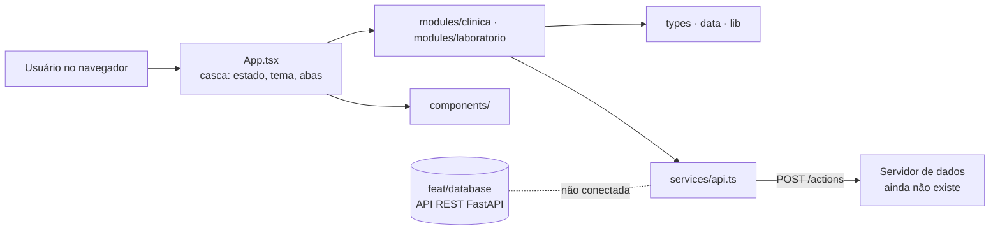

# Arquitetura do front-end

Visão técnica de como o app funciona. Baseada na leitura do código e em testes de renderização. Para a organização de pastas, veja [`estrutura.md`](estrutura.md).

## 1. Visão geral



É uma **SPA de página única**. Não há rotas de URL: a navegação é controlada por estado.

## 2. Navegação

O estado `view` define a tela:

| `view.kind` | Tela |
|---|---|
| `home` | Início: busca, alertas, sugestões da IA |
| `results` | Resultado da busca (`components/SectorSearchResults`) |
| `sector` | Página de um setor, com abas |

Dentro de um setor, o estado `sectorTab` escolhe a aba. A lista de abas (`sectorTabs`) é diferente para cada setor e cada aba renderiza um módulo (ver [`modulos.md`](modulos.md)). A busca interpreta o texto com `sectorIdForQuery` (aliases como "lab" e "clínica").

## 3. Estado

O estado global está em `App` (`src/App.tsx`): tema, tela atual, alertas (lidos, adiados, ignorados, resolvidos), previsões concluídas, pacientes, filtros, histórico de busca e preferências. São 33 `useState`. Cada módulo recebe o que precisa por *props* e guarda seu próprio estado interno.

## 4. Persistência e integração com o backend

Toda leitura/gravação passa por **uma função**, `api()` em `src/services/api.ts`:

```ts
POST "actions"   corpo: { action, args }   resposta: { data } ou { error }
```

| Ação | Uso | Chamadas no código |
|---|---|---|
| `records.list` | Lista os registros de uma coleção | 34 |
| `records.create` | Cria um registro (aceita `idempotency_key`) | 42 |
| `records.replace` | Substitui um registro pelo `id` | 18 |

Os dados ficam em **32 coleções** de chave-valor, todas com prefixo `gottcured_` (ex.: `gottcured_patients`, `gottcured_lab_pedidos`, `gottcured_alert_state`). Se o servidor não responde, a maioria das chamadas cai em `try/catch` e o app segue em memória com um aviso; ao recarregar, os dados somem.

### Descompasso com a API da branch `feat/database`

A branch `feat/database` traz um backend FastAPI com rotas REST tipadas. **Ele não atende o que o front chama hoje:**

| | Front-end (hoje) | Backend (`feat/database`) |
|---|---|---|
| Estilo | `POST /actions` genérico, coleções de chave-valor | REST tipado: `/patients`, `/professionals`, `/hospitals` |
| Cobertura | 32 coleções | 3 recursos (pacientes, profissionais, hospitais) |
| Campos do paciente | `birth`, `card`, `guardianRelation`… | `birth_date`, `insurance_card`, `guardian_name`… |
| Identificação | sem hospital/tenant | cabeçalho `X-Hospital-Id` (multi-hospital) |
| Login | nenhum | previsto (GC-3) |

Como todo acesso passa por `services/api.ts`, **esse arquivo é o ponto de adaptação**: ele pode traduzir `records.*` para as rotas REST à medida que o backend ganhar cobertura, sem mexer nos módulos. Isso é uma decisão de arquitetura da equipe, não algo resolvido aqui.

## 5. Dados de exemplo, "IA" e regras de negócio

- **Dados de exemplo (`SEED_*`)** alimentam as telas; ficam em `dados.ts` de cada módulo ou em `data/`.
- **Previsões e sugestões** (`PREDICTIVE_ALERTS`, `GLOBAL_AI`, `GESTOR_SUGS`, `LAB_INTEL_ITEMS`) são listas fixas. `buildAiAnswer` e as constantes `*_KEYWORDS` escolhem respostas por palavra-chave. Não há chamada a modelo de IA nem cálculo estatístico.
- **Regras de negócio já implementadas:**

| Regra | Função | Onde |
|---|---|---|
| Evitar paciente duplicado | `findDuplicatePatient` | `modules/clinica/pacientes/utils.ts` |
| Alergia, interação e duplicidade em prescrição | `checkDrug`, `drugClass` | `modules/clinica/prescricao/utils.ts` |
| Elegibilidade de pedido de exame | `labEligibility` | `modules/laboratorio/pedido-agendamento/utils.ts` |
| Repasse a profissionais | `calcRepasse` | `modules/clinica/equipe-produtividade/utils.ts` |
| Validade de insumos | `expiryStatus` | `modules/clinica/insumos/utils.ts` |
| Resultado fora da referência | `flagFor` | `modules/laboratorio/analise-resultados/utils.ts` |

- **Exportação:** `downloadCsv` gera CSV real; `downloadSimulatedPdf` grava **texto puro marcado como PDF**, que não é um PDF válido.

## 6. Visual

- `src/index.css` define variáveis de cor em `:root` e `[data-theme="dark"]`; o tema troca pelo atributo `data-theme`.
- Efeito de vidro fosco nas classes `.card` e `.soft`.
- As classes `.mac-*` vêm de um layout anterior em estilo janela de Mac; parte é sobreposta pelo layout atual de colunas e abas.
- Paleta: verde-petróleo `#0F5F5C`, destaque âmbar `#E4A11B`. Fontes: Fraunces (títulos) e Public Sans (texto).

## 7. Pontos de atenção

| # | Ponto | Gravidade | Sugestão |
|---|---|---|---|
| 1 | Front chama `/actions`; backend é REST tipado e cobre só 3 recursos | Alta | Decidir o contrato e adaptar `services/api.ts` |
| 2 | Sem autenticação nem perfis de acesso no front | Alta antes de dados reais | Login + papéis (gestor, médico, recepção, lab), alinhado ao GC-3 |
| 3 | Dados de saúde sem política de LGPD/auditoria | Alta antes de dados reais | Auditoria, criptografia, retenção, consentimento |
| 4 | Erros de `api()` engolidos em vários `catch {}` | Média | Registrar o erro e avisar o usuário |
| 5 | "PDF" simulado | Média | Gerar PDF real |
| 6 | Previsões de IA fixas, sem aviso na tela | Média | Rotular como "exemplo" ou integrar modelo real |
| 7 | 28 erros de `tsc` preexistentes; CI só roda `build` | Média | Zerar e passar a rodar `tsc` no CI |
| 8 | Sem testes automatizados | Média | Começar pelas funções das regras de negócio |
| 9 | `App.tsx` ainda concentra 33 estados e as condições de aba | Média | Mapa `aba → componente`; contextos |
| 10 | Código com linhas muito longas | Baixa | Prettier, em PR separado |
| 11 | CSS `.mac-*` legado | Baixa | Remover o que não for usado |
