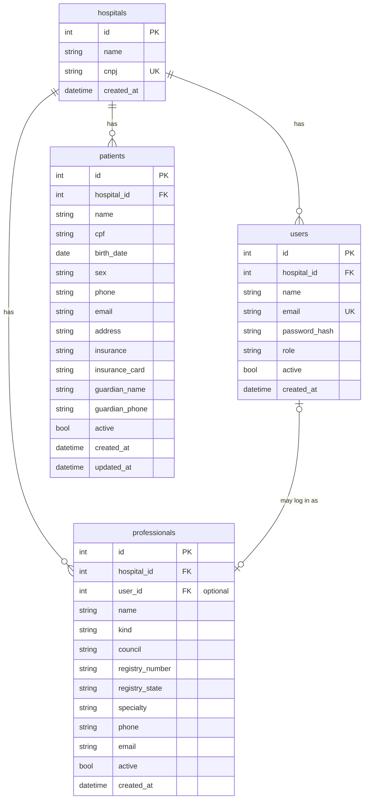

# Database model (GC-22)

Every record belongs to one hospital (`hospital_id`). A hospital never sees another hospital's data.

## Entity-relationship diagram

## Rules

| Rule | Where |
|---|---|
| Same CPF only once per hospital | `uq_patient_cpf_per_hospital` |
| Same professional registry (council + number + state) only once per hospital | `uq_professional_registry` |
| CNPJ and user email are unique in the whole system | `unique=True` |
| Records are never deleted, only deactivated (`active = false`) | repositories |

## Tests

| Folder | What it tests | Command |
|---|---|---|
| `tests/unit` | Repositories, table rules and migrations, without the API | `python -m pytest tests/unit` |
| `tests/integration` | The API end to end (routes, hospital isolation, errors) | `python -m pytest tests/integration` |

Each test runs on its own temporary SQLite database, so the tests never change `gc_dev.db`.
